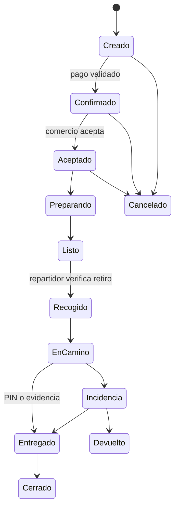

# Alcance funcional inicial

Contenido literal recuperado del chat de origen. Las referencias internas de ChatGPT no se han resuelto a documentos o URLs.

Sí. A partir de información pública y documentación oficial podemos reconstruir un alcance funcional equivalente al modelo de negocio de PedidosYa, sin copiar su código, diseño, marca ni procesos internos confidenciales.

## 1. Modelo de negocio identificado

La plataforma opera como un ecosistema multilateral que conecta:

- Clientes.
- Restaurantes y comercios.
- Repartidores.
- Operadores administrativos.
- Proveedores de pagos, mapas, identidad y comunicaciones.

Sus líneas principales son:

1. Marketplace de restaurantes.
2. Logística de última milla.
3. Marketplace de comercios: farmacias, mercados, mascotas, bebidas y otros.
4. Quick-commerce mediante tiendas propias o dark stores.
5. Servicio de reparto para comercios externos.
6. Suscripción del cliente.
7. Publicidad y posicionamiento patrocinado.
8. Promociones, cupones y programas de fidelización.
9. Servicios financieros y billetera digital.

La documentación pública confirma la administración de catálogos, precios, disponibilidad, promociones, pedidos, picking, packing, despacho y seguimiento en tiempo real. :chatgpt-content-reference{index="0"}

---

# 2. Aplicaciones del ecosistema

## A. Aplicación del cliente

Disponible como aplicación móvil y portal web.

### Registro y cuenta

- Registro mediante correo, teléfono o identidad federada.
- Inicio de sesión y recuperación de acceso.
- Verificación por OTP.
- Gestión del perfil.
- Términos, privacidad y consentimientos.
- Eliminación o desactivación de cuenta.
- Administración de sesiones y dispositivos.

### Direcciones y ubicación

- Geolocalización actual.
- Búsqueda de dirección en mapa.
- Direcciones guardadas.
- Referencias de entrega.
- Casa, trabajo u otra dirección.
- Validación de cobertura.
- Selección de entrega en puerta o recepción.
- Instrucciones para el repartidor.

### Descubrimiento

- Restaurantes cercanos.
- Comercios por categoría.
- Búsqueda por nombre, plato o producto.
- Filtros por precio, distancia, valoración y tiempo.
- Costo de envío.
- Promociones disponibles.
- Recomendaciones personalizadas.
- Comercios favoritos.
- Historial de búsquedas.
- Restaurantes patrocinados.

### Catálogo y productos

- Categorías y subcategorías.
- Productos con imágenes y descripciones.
- Precio normal y promocional.
- Variantes: tamaño, presentación o sabor.
- Modificadores y adicionales.
- Observaciones del cliente.
- Disponibilidad y stock.
- Restricciones horarias.
- Productos relacionados.
- Información de alérgenos cuando corresponda.

### Carrito

- Agregar, modificar y eliminar productos.
- Validación de cantidad y disponibilidad.
- Cálculo de subtotal.
- Costo de envío.
- Tarifa de servicio.
- Impuestos.
- Descuentos y cupones.
- Propina.
- Pedido mínimo.
- Reemplazos para productos sin stock.
- Un carrito por comercio.

### Checkout y pagos

- Confirmación de dirección.
- Entrega inmediata o programada.
- Tarjeta de crédito o débito.
- Efectivo, cuando esté habilitado.
- Billetera o saldo interno.
- Cupones y créditos.
- Pago mixto.
- Tokenización de tarjetas.
- Validación antifraude.
- Comprobante electrónico.

Los términos públicos contemplan pagos electrónicos, saldo en billetera, reembolsos y ajustes cuando existen productos faltantes o reemplazos. :chatgpt-content-reference{index="1"}

### Seguimiento del pedido

- Pedido registrado.
- Pendiente de confirmación.
- Aceptado por el restaurante.
- En preparación.
- Listo para recoger.
- Repartidor asignado.
- Repartidor en el comercio.
- Pedido recogido.
- En camino.
- Repartidor próximo.
- Entregado.
- Cancelado o con incidencia.
- Seguimiento del repartidor en mapa.
- Tiempo estimado actualizado.
- Chat o llamada anonimizada.
- Notificaciones push, SMS o correo.

### Posventa

- Historial y detalle de pedidos.
- Repetir pedido.
- Descargar comprobante.
- Calificar restaurante.
- Calificar repartidor.
- Reportar producto incorrecto o faltante.
- Pedido no entregado.
- Solicitar ayuda.
- Crédito, devolución parcial o total.
- Gestión de reclamos.

### Suscripción

- Plan mensual o anual.
- Beneficios de envío.
- Comercios elegibles.
- Condiciones de pedido mínimo.
- Renovación automática.
- Cambio o cancelación del plan.
- Historial de cobros.

---

## B. Aplicación del restaurante o comercio

Debe incluir una aplicación operativa para pedidos y un portal administrativo.

### Afiliación

- Registro del negocio.
- RUC, razón social y representante.
- Cuenta bancaria.
- Documentación legal.
- Contrato y aceptación de comisión.
- Validación administrativa.
- Alta de una o varias sucursales.
- Configuración tributaria.
- Activación y suspensión.

Los requisitos públicos para Perú incluyen RUC, razón social, documento de identidad y cuenta bancaria. :chatgpt-content-reference{index="2"}

### Organización del comercio

- Cadena o marca.
- Una o varias sucursales.
- Usuarios y roles por sucursal.
- Horarios regulares y especiales.
- Días feriados.
- Tiempo estimado de preparación.
- Radio y zona de cobertura.
- Pedido mínimo.
- Métodos de entrega.
- Pausa temporal del establecimiento.

### Catálogo

- Menús por sucursal.
- Categorías y productos.
- SKU interno.
- Variantes y modificadores.
- Precios por sucursal.
- Imágenes.
- Disponibilidad.
- Stock.
- Horarios de venta.
- Productos agotados temporalmente.
- Carga masiva.
- Importación y exportación.
- Integración mediante API o webhooks.

La API pública permite consultar catálogo y modificar precio, cantidad y estado de los productos, incluso mediante procesos masivos asíncronos. :chatgpt-content-reference{index="3"}

### Operación de pedidos

- Alerta de nuevo pedido.
- Aceptar o rechazar.
- Indicar tiempo de preparación.
- Visualizar detalle y observaciones.
- Gestionar productos faltantes.
- Proponer reemplazos.
- Iniciar preparación.
- Marcar pedido listo.
- Entregar al repartidor.
- Verificar código de retiro.
- Cancelar con motivo autorizado.
- Imprimir comanda.
- Historial operativo.
- Gestión de pedidos programados.

### Promociones

- Descuento porcentual.
- Descuento fijo.
- Precio promocional.
- Descuento por producto.
- Combos.
- Envío gratuito.
- Compra mínima.
- Programación de inicio y fin.
- Presupuesto promocional.
- Participación del comercio o plataforma.
- Activación y desactivación.
- Resultados de campaña.

La solución pública permite crear, modificar, desactivar y consultar promociones, incluyendo productos, fechas y estados. :chatgpt-content-reference{index="4"}

### Finanzas

- Ventas brutas.
- Comisiones.
- Tarifa logística.
- Descuentos asumidos.
- Impuestos.
- Cancelaciones y devoluciones.
- Ajustes.
- Propinas cuando corresponda.
- Liquidaciones.
- Estado de cuenta.
- Comprobantes.
- Pagos por transferencia.
- Conciliación.

En Perú, el Partner Portal muestra estados de cuenta y fechas de pago, con liquidaciones y transferencias semanales. :chatgpt-content-reference{index="5"}

### Analítica

- Pedidos recibidos y aceptados.
- Ventas por periodo.
- Ticket promedio.
- Productos más vendidos.
- Cancelaciones.
- Tiempo de aceptación.
- Tiempo de preparación.
- Disponibilidad operativa.
- Rendimiento de promociones.
- Calificaciones.
- Comparación entre sucursales.

---

## C. Aplicación del repartidor

### Incorporación

- Registro.
- Verificación de teléfono y correo.
- Documento de identidad.
- Licencia, cuando corresponda.
- Datos del vehículo.
- Cuenta bancaria.
- Revisión documental.
- Capacitación.
- Activación, bloqueo y suspensión.

### Disponibilidad

- Estado conectado o desconectado.
- Selección de zona.
- Reserva de turnos, si se aplica.
- Visualización de alta demanda.
- Objetivos e incentivos.
- Control de pausas.

### Asignación

- Recepción de oferta.
- Distancia hasta el comercio.
- Distancia estimada al cliente.
- Ganancia estimada.
- Tiempo para aceptar.
- Aceptar o rechazar.
- Asignación automática.
- Reasignación.
- Pedidos agrupados o múltiples.

### Recogida

- Navegación al comercio.
- Aviso de llegada.
- Código o PIN de retiro.
- Confirmación de productos o paquetes.
- Reporte de demora.
- Reporte de comercio cerrado.
- Reporte de pedido no preparado.
- Inicio de entrega.

### Entrega

- Navegación al cliente.
- Ubicación GPS en tiempo real.
- Comunicación anonimizada.
- Confirmación mediante PIN, firma o fotografía.
- Registro de intento fallido.
- Incidente por dirección incorrecta.
- Devolución al comercio.
- Prueba de entrega.

### Ganancias

- Ganancia por pedido.
- Distancia recorrida.
- Bonificaciones.
- Incentivos.
- Propinas.
- Ajustes.
- Saldo disponible.
- Historial de pagos.
- Liquidaciones y retiros.

### Seguridad y soporte

- Botón de emergencia.
- Reporte de accidente.
- Bloqueo de clientes conflictivos.
- Detección de GPS irregular.
- Soporte durante una entrega.
- Protección de información personal.
- Evaluación del repartidor.

---

## D. Administración central

### Gestión de participantes

- Clientes.
- Restaurantes y comercios.
- Cadenas y sucursales.
- Repartidores.
- Operadores internos.
- Roles y permisos.
- Validación documental.
- Suspensión y reactivación.
- Listas de observación.

### Gestión geográfica

- Países, ciudades y distritos.
- Polígonos de cobertura.
- Zonas de reparto.
- Zonas restringidas.
- Distancias máximas.
- Tarifas por zona.
- Horarios por zona.
- Demanda y capacidad operativa.

### Gestión de pedidos

- Consulta global.
- Línea de tiempo completa.
- Localización del repartidor.
- Cambio o reasignación controlada.
- Cancelación administrativa.
- Gestión de productos faltantes.
- Compensaciones.
- Evidencias.
- Auditoría de modificaciones.

### Motor logístico

- Búsqueda de repartidores cercanos.
- Asignación por distancia y capacidad.
- Compatibilidad con tipo de vehículo.
- Tiempo estimado de preparación.
- Pedidos agrupados.
- Balance de demanda y oferta.
- Reasignación automática.
- Priorización.
- Control de entrega tardía.
- Cálculo dinámico del ETA.

### Tarifas y comisiones

- Comisión por comercio.
- Comisión por categoría.
- Costo base de envío.
- Tarifa por distancia.
- Tarifa por zona.
- Tarifa por alta demanda.
- Tarifa de servicio.
- Pedido mínimo.
- Incentivos al repartidor.
- Subsidios y distribución del descuento.
- Vigencias y versionado.

### Pagos y conciliación

- Transacciones.
- Autorizaciones y capturas.
- Pagos en efectivo.
- Reembolsos.
- Contracargos.
- Conciliación con pasarela.
- Cuentas por pagar a comercios.
- Cuentas por pagar a repartidores.
- Comisiones de la plataforma.
- Cierres y liquidaciones.
- Exportación contable.
- Auditoría financiera.

### Promociones y marketing

- Cupones.
- Campañas segmentadas.
- Referidos.
- Descuentos financiados por plataforma o comercio.
- Publicidad patrocinada.
- Banners.
- Posicionamiento en resultados.
- Notificaciones segmentadas.
- Medición de conversiones.
- Prevención del abuso de promociones.

### Atención al cliente

- Casos y tickets.
- Chat de soporte.
- Motivos parametrizables.
- SLA y escalamiento.
- Reembolsos y créditos.
- Evidencias adjuntas.
- Historial de contacto.
- Base de conocimiento.
- Automatización de respuestas.

### Riesgo y fraude

- Múltiples cuentas.
- Cupones abusivos.
- Pagos sospechosos.
- Pedidos ficticios.
- Colusión entre actores.
- GPS manipulado.
- Cancelaciones reiteradas.
- Dispositivos bloqueados.
- Reglas de riesgo.
- Revisión manual.

### Configuración y auditoría

- Parámetros globales.
- Feature flags.
- Plantillas de mensajes.
- Versiones de términos.
- Auditoría de acciones.
- Trazabilidad de accesos.
- Gestión de datos personales.
- Retención y anonimización.
- Configuración por país.

---

# 3. Líneas de negocio adicionales

## Marketplace de comercios

La misma plataforma puede admitir:

- Farmacias.
- Supermercados.
- Licorerías.
- Tiendas de conveniencia.
- Mascotas.
- Electrónica.
- Florerías y regalos.

Aquí se agregan inventario, sustitución de productos, venta por peso, límites de edad y picking.

## Quick-commerce y dark stores

Requiere una aplicación adicional para almacén:

- Recepción de inventario.
- Ubicaciones internas.
- Lotes y vencimientos.
- Stock en tiempo real.
- Picking guiado.
- Sustituciones.
- Packing.
- Conteos y ajustes.
- Mermas.
- Despacho.
- Reabastecimiento.

PedidosYa identifica públicamente esta operación como quick-commerce y confirma que el partner controla catálogo, precios, promociones, picking y packing. :chatgpt-content-reference{index="6"}

## Delivery como servicio

Permite que un comercio externo cree una entrega sin vender en el marketplace:

- API para solicitar una entrega.
- Origen y destino.
- Cotización.
- Seguimiento.
- Prueba de entrega.
- Cancelación.
- Webhooks.
- Facturación empresarial.

PedidosYa ofrece públicamente integración logística de última milla para tiendas externas. :chatgpt-content-reference{index="7"}

---

# 4. Ciclo funcional principal

Cada transición debe producir:

- Evento de dominio.
- Registro de auditoría.
- Notificación correspondiente.
- Actualización de tiempos estimados.
- Revisión financiera si afecta cobros o liquidaciones.

---

# 5. Fuentes de ingresos del modelo

| Fuente | Descripción |
|---|---|
| Comisión | Porcentaje sobre cada venta del comercio |
| Tarifa de envío | Pagada total o parcialmente por el cliente |
| Tarifa de servicio | Cargo adicional por uso de la plataforma |
| Suscripción | Beneficios recurrentes para clientes |
| Publicidad | Posicionamiento, banners y resultados patrocinados |
| Promociones compartidas | Financiamiento entre plataforma y comercio |
| Logística B2B | Entregas para tiendas externas |
| Margen comercial | Venta directa desde dark stores |
| Servicios financieros | Créditos, anticipos u otros productos futuros |

---

# 6. MVP recomendado

Para evitar construir desde el comienzo toda la complejidad de PedidosYa, la primera versión debería limitarse a restaurantes y entrega inmediata.

## Incluido en el MVP

- Aplicación móvil del cliente.
- Portal web y aplicación operativa del restaurante.
- Aplicación móvil del repartidor.
- Portal administrativo.
- Registro y autenticación.
- Restaurantes, sucursales, horarios y cobertura.
- Menús, productos, variantes y adicionales.
- Carrito y checkout.
- Pago con tarjeta y efectivo configurable.
- Gestión completa del pedido.
- Asignación básica de repartidor.
- GPS y seguimiento en tiempo real.
- Notificaciones.
- Cancelaciones e incidencias esenciales.
- Comisiones y liquidaciones.
- Cupones básicos.
- Calificaciones.
- Reportes operativos.
- Auditoría y soporte básico.

## Para una segunda etapa

- Entregas programadas.
- Pedidos agrupados.
- Promociones avanzadas.
- Publicidad patrocinada.
- Suscripción.
- Billetera.
- Sistema de referidos.
- Chat avanzado.
- Motor antifraude.
- Tarifas dinámicas.
- Integraciones POS.
- API para cadenas.

## Para una tercera etapa

- Supermercados y farmacias.
- Dark stores.
- Picking especializado.
- Delivery como servicio.
- Optimización logística avanzada.
- Recomendaciones mediante IA.
- Créditos y servicios financieros.

---

# 7. Aplicaciones que construiremos

| Solución | Canal recomendado |
|---|---|
| Cliente | Flutter para Android/iOS y Angular para web |
| Restaurante operativo | Flutter para tablet/móvil |
| Portal del restaurante | Angular |
| Repartidor | Flutter |
| Administración central | Angular |
| Operación y soporte | Angular |
| Backend | .NET modular |
| Integraciones externas | APIs REST, webhooks y eventos |

Este alcance nos da una base funcional comparable con PedidosYa, pero suficientemente modular para crear un producto propio. El siguiente paso conveniente es convertirlo en una **matriz formal de módulos, funcionalidades, roles, reglas de negocio y prioridades MVP**, antes de diseñar la arquitectura o programar.

