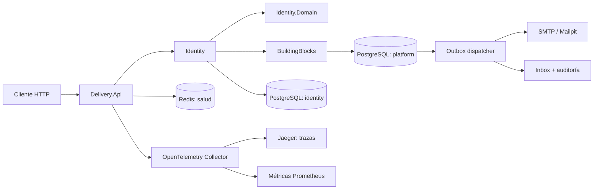

# Arquitectura de la Iteración cero

Documento histórico. Los originales ya están disponibles y la implementación actual de Identity se describe en [EP-01](../epica-1/README.md).

Fecha: 14 de octubre de 2026.

Decisión: monolito modular con un host y módulos propietarios de sus datos. La documentación original menciona doce contextos, pero sus nombres y límites completos no están recuperados. Esta base introduce Identity; los demás módulos se incorporarán cuando se confirme ese documento.

| Proyecto | Responsabilidad | Dependencias internas |
|---|---|---|
| Delivery.Api | Composición, HTTP, JWT, errores, correlación, telemetría y salud | Identity |
| Delivery.Modules.Identity | Casos de uso, endpoints y adaptadores PostgreSQL/SMTP | Identity.Domain, BuildingBlocks |
| Delivery.Modules.Identity.Domain | Política pura de desafíos OTP | Ninguna |
| Delivery.BuildingBlocks | Excepciones, telemetría, contratos y dispatcher Outbox/Inbox | Ninguna |
| Delivery.Tests | Pruebas de dominio, límites arquitectónicos e integración HTTP/SQL | API |

## Persistencia y consistencia

Identity es propietario de usuarios, desafíos y auditoría de registros. Platform posee las tablas de mensajería. No hay tablas de negocio compartidas entre futuros módulos ni consultas entre sus esquemas.

Se usa Npgsql 10 con SQL parametrizado y una migración SQL embebida, versionada y transaccional. Este enfoque mantiene explícitos los bloqueos y la atomicidad del primer slice. No se usa un ORM en esta base. Las migraciones futuras deben agregarse como versiones nuevas, sin modificar el baseline ya aplicado.

La solicitud crea el desafío y el mensaje Outbox en una transacción. La verificación consume el código, crea el usuario y publica UserRegistered en otra transacción. Un bloqueo asesor por correo serializa solicitudes y verificaciones; el bloqueo de fila protege el desafío. Los bloqueos se adquieren en el mismo orden para evitar interbloqueos.

Outbox lee lotes de una fila con FOR UPDATE SKIP LOCKED. Inbox tiene una clave compuesta (message_id, consumer). El registro de Inbox y las escrituras del consumidor se confirman junto con el estado de Outbox. Los fallos deshacen el consumidor y programan reintentos exponenciales hasta diez intentos.

SMTP es un efecto externo: si el proceso cae después del envío y antes del commit puede repetirse el correo. No se promete entrega exactamente una vez. El código sigue siendo de un solo uso. Se omiten correos de desafíos consumidos o vencidos y se limpia el payload tras el procesamiento.

## Observabilidad y componentes comunes

- Problem Details para errores HTTP, con code cuando corresponde, traceId y correlationId.
- X-Correlation-ID aceptado con máximo 64 caracteres ASCII seguros; en otro caso se genera uno.
- Logs JSON con scopes; no se registran códigos, tokens ni cuerpos de solicitudes.
- Instrumentación OpenTelemetry de ASP.NET Core/HttpClient y actividades del dispatcher.
- Contadores de solicitud/verificación OTP y mensajes procesados/fallidos.
- Collector local: trazas a Jaeger, métricas a endpoint Prometheus, logs al exporter debug.
- Health checks separados de vida y disponibilidad.

## Referencias técnicas consultadas

- [Errores de API en ASP.NET Core](https://learn.microsoft.com/en-us/aspnet/core/fundamentals/error-handling-api?view=aspnetcore-10.0)
- [Npgsql 10](https://www.npgsql.org/doc/release-notes/10.0.html)
- [OpenTelemetry .NET](https://opentelemetry.io/docs/languages/dotnet/)
- [Imagen PostgreSQL/PostGIS](https://github.com/postgis/docker-postgis)
- [Mailpit Docker](https://mailpit.axllent.org/docs/install/docker/)
